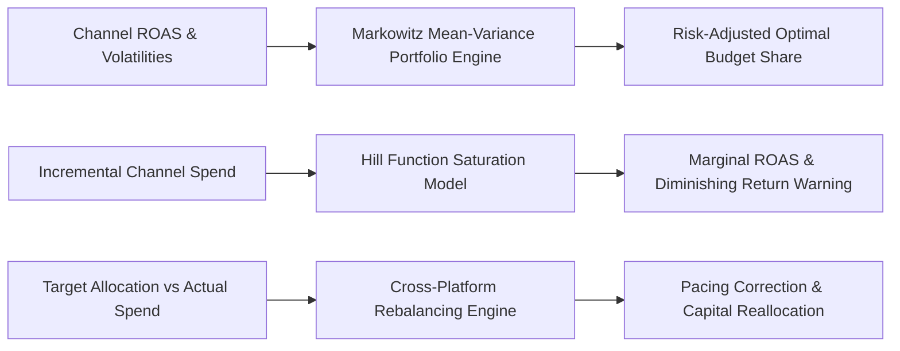

# genpark-cross-platform-allocator


GenPark Cross-Platform Allocator is a zero-dependency quantitative paid media and performance marketing optimization engine implementing Markowitz Modern Portfolio Theory for ad budget distribution, Hill function diminishing marginal ROAS curves, and automated cross-channel spend drift rebalancing.



## Features
- **Markowitz Mean-Variance Ad Portfolio**: Optimizes multi-channel spend based on expected ROAS and channel volatility trade-offs.
- **Hill Function Saturation Modeling**: Detects marginal efficiency decay ($dRev / dB$) to prevent ad spend waste above saturation thresholds.
- **Cross-Platform Rebalancing**: Identifies pacing drift across Google, Meta, TikTok, and Amazon to issue corrective capital adjustments.

## Quickstart

```python
from client import GenParkCrossPlatformAllocator

allocator = GenParkCrossPlatformAllocator()
res = allocator.optimize_markowitz_ad_budget(
    [{"name": "Google", "expected_roas": 4.5, "roas_volatility_std": 0.3},
     {"name": "Meta", "expected_roas": 3.8, "roas_volatility_std": 0.5}],
    total_budget_usd=10000.0
)
print("Blended ROAS:", res["blended_portfolio_roas"])
```

## License
MIT
